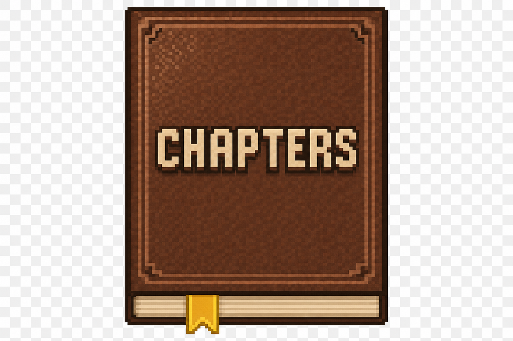

# Chapters (NeoForge 1.21.1)

<p align="center">
  
</p>

Chapters locks items, fluids, recipes, and dimensions behind **stages** until you grant them.

A stage is an id you choose, like `mypack:iron_age`. The `/chapters` commands, KubeJS, and the FTB Quests Stage fields all use that same id.

The jar ships **no** stages. You write them.

**Guide, recipes, and troubleshooting: [GitHub Wiki](https://github.com/GabinFqt/chapters/wiki)**

This page is the **Minecraft 1.21** line (Chapters **1.x**, Java 21). Minecraft 26 uses Chapters **2.x**.

## What you can lock

- **Items.** Hidden in JEI, no ground pickup, dropped from the inventory (about once a second), no crafting on the vanilla grid.
- **Fluids.** The player cannot place them or move them with buckets and tanks. JEI hides them.
- **One recipe.** That recipe id will not craft on the vanilla grid, and JEI hides it. The output item stays free unless you also lock the item.
- **Dimensions.** Travel is cancelled (portals, `/tp`). Players already inside are sent back to the Overworld.
- **A whole mod.** `@create` locks that mod's items, fluids, and Mekanism chemicals. It does not lock dimensions. Add a `dimension:` line for those.
- **Mekanism chemicals**, when Mekanism is installed. The player cannot move them by hand. JEI hides them. This exists on the 1.21 line only.

You can soften a lock (keep it visible in JEI, or let the player hold the item). See [Restriction flags](https://github.com/GabinFqt/chapters/wiki/Restriction-flags). Most packs should leave the defaults: fully locked until the stage is granted.

Chapters runs on its own. KubeJS is how the example below is written. A [datapack](https://github.com/GabinFqt/chapters/wiki/Stages-datapack) works if you do not want scripts. JEI, FTB Quests, FTB Teams, and Mekanism are optional.

## Example

Install KubeJS. Put this in `kubejs/server_scripts/stages.js`:

```js
ServerEvents.loaded(() => {
  ChaptersEvents.defineStage('mypack:iron_age', [
    '@create',
    'dimension:minecraft:the_nether'
  ])
})
```

Reload server scripts (`/kubejs reload server-scripts`, or restart). `ServerEvents.loaded` does not run on `/reload`. `/chapters reload` is that same resource reload: it picks up datapack JSON, and it does not re-run KubeJS.

```
/chapters check Steve mypack:iron_age
/chapters add Steve mypack:iron_age
```

Nothing from Create, and no Nether, until that stage is granted.

With **FTB Quests**, add a Stage Reward and type `mypack:iron_age`. No extra plugin. With **FTB Teams**, the whole party gets the stage. Details: [FTB](https://github.com/GabinFqt/chapters/wiki/FTB-integration).

Copy-paste recipes: [Examples](https://github.com/GabinFqt/chapters/wiki/Examples). Sample scripts in this repo: [`examples/kubejs`](examples/kubejs/).

## What stays possible

- Smithing tables, mechanical crafters, and other machines can still craft. Lock the item as well when those must stay closed.
- Pipes and other automation can still move locked fluids and chemicals. A player clicking a tank is blocked.
- Mekanism chemicals need Mekanism, and they exist on this 1.21 line only. Chapters **2.x** (Minecraft 26) ignores them.

Full list: [Limits](https://github.com/GabinFqt/chapters/wiki/Limits).

## Commands

| Command | What it does |
| --- | --- |
| `/chapters add <player> <stage>` | Grants the stage |
| `/chapters remove <player> <stage>` | Revokes it |
| `/chapters list <player>` | Stages that player has |
| `/chapters check <player> <stage>` | `true` or `false` |
| `/chapters reload` | Re-reads datapack JSON (same as `/reload`). Does not re-run KubeJS |

## Wiki

| Page | Use it when |
| --- | --- |
| [Home](https://github.com/GabinFqt/chapters/wiki) | You are wiring Chapters into a pack |
| [Examples](https://github.com/GabinFqt/chapters/wiki/Examples) | You want a script for one case |
| [KubeJS](https://github.com/GabinFqt/chapters/wiki/KubeJS) | You need a prefix or a method |
| [Restriction flags](https://github.com/GabinFqt/chapters/wiki/Restriction-flags) | You want to soften a lock |
| [FTB](https://github.com/GabinFqt/chapters/wiki/FTB-integration) | You use Quests or Teams |
| [Limits](https://github.com/GabinFqt/chapters/wiki/Limits) | You need to know what is still unguarded |
| [Datapack](https://github.com/GabinFqt/chapters/wiki/Stages-datapack) | You do not want KubeJS |
| [Troubleshooting](https://github.com/GabinFqt/chapters/wiki/Troubleshooting) | A lock does not do what you expected |

## For contributors

### Development

Requirements: Java 21, NeoForge 21.1.x.

```bash
./gradlew build
```

Wiki sources live in [`wiki/`](wiki/). Keep `wiki/` and [`DESCRIPTION.md`](DESCRIPTION.md) identical on `main` and `26`. Publish with `./scripts/publish-wiki.sh` (needs [`gh`](https://cli.github.com/) auth). Create the wiki's first page on GitHub if `*.wiki.git` is missing.

### Releases

Tag this branch `v1.0`, `v1.1`, … matching `mod_version` in [`gradle.properties`](gradle.properties). Pushing a `v1.*` tag runs GitHub Actions (build, GitHub Release, Modrinth and CurseForge via `publishMods`). Use `v2.*` only on branch `26`.

Publishing uses the [`mod-publish-plugin`](https://modmuss50.github.io/mod-publish-plugin/).

1. Create the projects on [Modrinth](https://modrinth.com/dashboard/projects) and [CurseForge](https://authors.curseforge.com). CurseForge requires manual approval before the first publish.
2. Fill `modrinth_project_id` and `curseforge_project_id` in [`gradle.properties`](gradle.properties).
3. Create tokens. Modrinth: [personal access tokens](https://modrinth.com/settings/pats), scope `Create versions`. CurseForge: [API tokens](https://legacy.curseforge.com/account/api-tokens).
4. Update [`CHANGELOG.md`](CHANGELOG.md). Its full content becomes the release notes. Paste [`DESCRIPTION.md`](DESCRIPTION.md) into the project pages when the storefront text changes.
5. Load tokens from a gitignored [`.env`](.env.example), bump `mod_version`, then publish:

```bash
set -a && source .env && set +a && ./gradlew publishMods
```

Platforms with an empty project id are skipped.

### License

MIT. See [LICENSE](LICENSE).

Issues and pull requests are welcome. Run `./gradlew build` before submitting.
